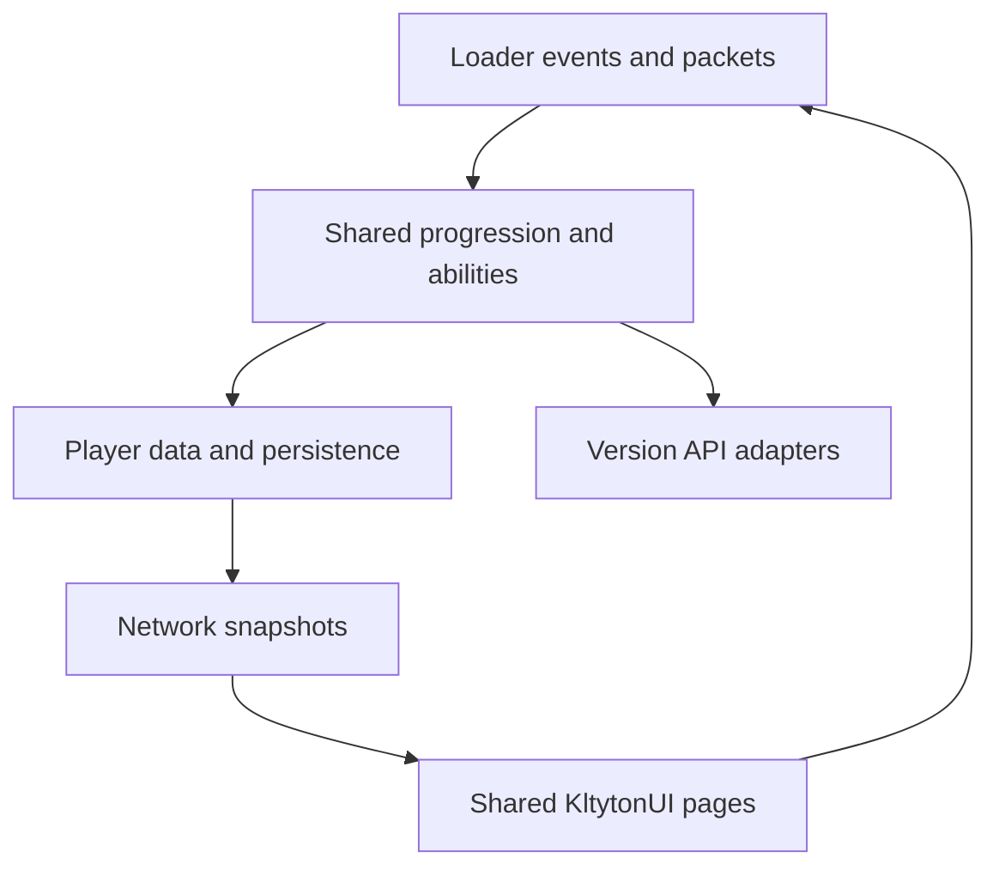

# Darwin Soldier architecture

The two Loader targets compile the same shared gameplay and interface sources in their matching Minecraft environments. Version adapters handle item components, attribute identifiers, effect holders and vertex APIs. Loader adapters own event registration, native configuration and packet transport.

Configuration keys, defaults, ranges and migration rules are defined once. Typed configuration values delegate reads, writes, validation and saving to ForgeConfigSpec or ModConfigSpec. Interfaces display staged values and request server changes through the existing protocol.

Growth retains five allocation rows, seven ability selectors and combat information. Targeting retains category filters and a searchable entity list; configuration retains categories and editable fields; aiming retains weapon-specific parameters; adaptation retains its record table. Shared page CSS supplies layout and the Ore theme's supported tokens.

Player UUIDs, registry identifiers, packet field order and saved-data keys retain their existing meanings. Each target uses its own generated-resource directory and native registry, Mixin and refmap pipeline.
