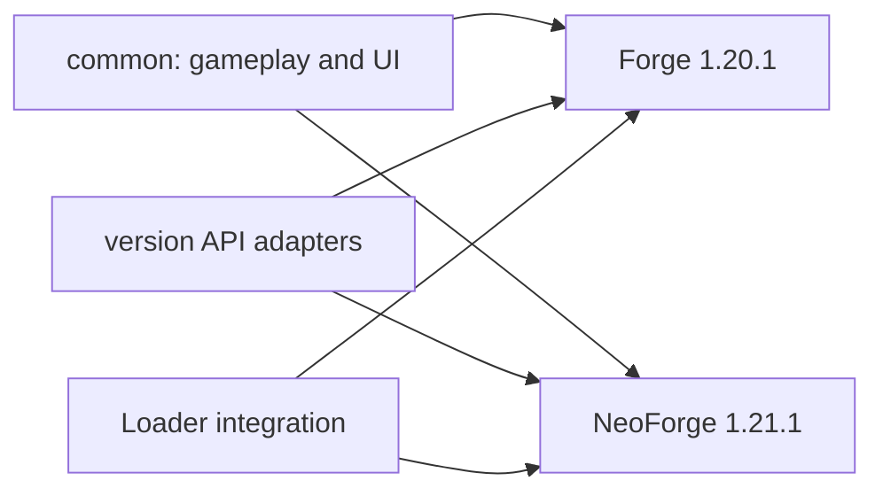

# Darwin Soldier

Grow stronger through combat, allocate permanent attributes, and unlock adaptive survival, targeting, and battle abilities. Darwin Serum enables persistent progression with five attribute paths and seven active or passive abilities. Player data, damage rules and ability state are controlled by the server.

## Supported targets

| Minecraft | Loader | Java |
| --- | --- | --- |
| 1.20.1 | Forge 47.4.20+ | 17 |
| 1.21.1 | NeoForge 21.1.248+ | 21 |

KltytonUI 1.2.7 and Rhino are bundled. Better Combat, Thirst Was Taken, Legendary Survival Overhaul and the matching TaCZ build are optional integrations.

## Development

The project uses [KltytonTemple](https://github.com/kltyton/KltytonTemple). Shared gameplay, data and UI code live in `common`; Minecraft API differences live in `versions`; Loader entry points, events, configuration and networking adapters live in `loaders`. Each target retains its own Wrapper, mapping and dependency pins.



Use Java 21 for the root Gradle controller. The target toolchains compile game code for Java 17 and Java 21 respectively.

```sh
./gradlew build_forge_1_20_1
./gradlew build_neoforge_1_21_1
./gradlew buildAllTargets
```

On Windows use `.\gradlew.bat`. Release JARs are written to each target's `build/libs` directory. `runClient_forge_1_20_1` and `runClient_neoforge_1_21_1` select the development client; `runDatagen_<target>` updates that target's generated resources. Handwritten assets remain in their source layers.

The template build controller retains its MIT notice in `LICENSES/KltytonTemple-MIT.txt`. Game code remains licensed under LGPLv3.
